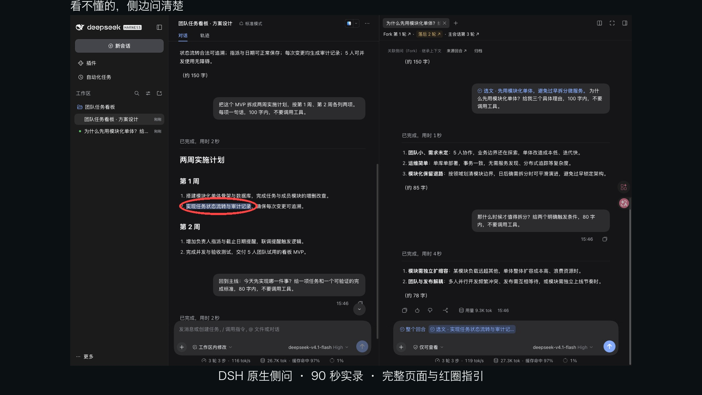

# dsh-sidecar-conversation

**Don't understand part of an AI answer? Ask beside it, without cluttering your main Session's context.**

In DeepSeek Harness Web, select unfamiliar text and ask for an explanation in the native right sidebar. Follow-up questions and explanations stay in their own Session, without being written back into your main conversation. You can also ask about a whole turn or fork from an earlier point, with separate messages, drafts, model and permissions.

[简体中文](./README.zh.md) · [GitHub Release](https://github.com/gosomea/dsh-sidecar-conversation/releases/tag/v0.2.4) · [npm](https://www.npmjs.com/package/dsh-sidecar-conversation)

## Quick install

With DSH Web already installed, run this command in the same environment and `DSH_HOME` you use to start it:

```sh
dsh plugin --profile web add dsh-sidecar-conversation@0.2.4
```

Restart DSH Web and refresh the page. Keep your existing `DSH_HOME` to preserve conversations and Sidecar history. No DSH source changes or Better Sidebar installation are needed. Version `0.2.4` has been verified with official npm DSH `0.2.1-alpha.3`.

Select text in a completed answer, or click “侧问这个回合”, then choose Fork or a references-only conversation and ask on the right.

## Watch the 90-second demo

[](https://www.bilibili.com/video/BV1NKHP63E7h/)

[Watch on Bilibili](https://www.bilibili.com/video/BV1NKHP63E7h/): real multi-turn conversations in an isolated environment, showing Fork, references-only Sessions, appended references, precise source navigation, native composer controls and history recovery. The full page stays visible, with red circles marking the focus. Waiting is edited out; some operations are sped up, with AI voice narration.

## What you can do

- **Explain part of an answer:** select unfamiliar text and ask about it with a source reference.
- **Continue an existing Sidecar:** append new text or a whole-turn reference to the most recently used Sidecar without losing its draft question.
- **Explore another direction:** fork an earlier turn's context while the main conversation continues its work.
- **Start with references only:** create an independent Session containing explicit references and your question, without inheriting the full conversation.

The right-hand chat uses DSH's native composer: file uploads, model and reasoning selection, permission controls, messages, tool calls, approvals, stop and error displays. A Sidecar supports continued conversation across multiple turns.

## Two entry points, the same choices

Select text in a completed Assistant answer, or click “侧问这个回合” at the end of a turn, to open the action menu.

| Menu action | Text selection | Whole turn |
| --- | --- | --- |
| 追加到最近侧问 (append) | Add the selected text to the target draft | Add a whole-turn reference to the target draft |
| 从此回合 Fork | Inherit history through the selection's turn and attach its text reference | Inherit history through the turn and attach its turn reference |
| 仅用选文新建／仅用此回合新建 (independent) | Start with only the selected text | Start with only that turn's final Assistant answer |

Append appears only when the current main Session has a prepared Sidecar whose tab remains open. Both menus have two creation choices, optionally preceded by append. The text-selection menu ends with “添加到主会话” (add to main Session), which inserts the same clickable reference into the native main composer without creating or switching a Sidecar. Drafts and sent citations retain exact-selection highlighting. If the right dock is collapsed but the tab remains open, append reveals the target Sidecar. Closed tabs and unprepared drafts are not eligible targets.

The left menu determines the creation mode. Choosing a new chat prepares its Session and opens the native composer directly, without another mode choice or an automatic model call. The new draft contains only the current source and does not copy another Sidecar's selections.

## From references to continued conversation

1. Select text or a turn on the left, then choose append, independent creation or Fork.
2. Edit your question on the right and choose files, model and permissions as needed. Add references from the left one at a time, or remove individual draft references.
3. Click a draft reference to return to its source: a text reference highlights only the selected text; a whole-turn reference highlights the turn. Sent references remain clickable.
4. Continue in the current Sidecar after sending. Switching main Sessions, reopening tabs and refreshing restore each child Session's state without mixing selections or returning to an older Sidecar.

Selections are limited to 4,000 characters. A whole-turn reference points to the final Assistant answer; independent Sessions receive that explicit reference, while only Fork inherits earlier history. Missing or unreadable sources produce an error while preserving the reference.

## Fork and independent Sessions

| | Linked Sidecar (Fork) | Independent Session |
| --- | --- | --- |
| Context | Main conversation history through the selected turn | Only explicitly added references and questions |
| Native relationship | Child of the main Session | No native parent, alongside the main Session |
| Fork progress | Links the fork turn, lag count and latest parent turn | Indicates references only, without a Fork gap |
| History entry | Listed in the source Session's Sidecar history | Also recoverable from the source Session's Sidecar history |

A Fork contains context from the point of branching and does not follow the main conversation live. The progress row updates when the main Session adds turns; appending references neither reduces the lag count nor merges later history automatically.

Both modes use the source workspace. Menu-created chats use DSH’s native read-only preset and permission menu. The `inherit` permission option copies the main Session’s current preset once; later permission changes are independent. Genuine custom permissions retain their native sandbox and approval values. Tools with write access modify the same workspace files. Read-only does not imply network isolation. Sidecar messages belong to their own Session and are not automatically sent back to the main conversation.

## Titles, history and recovery

Initial titles summarize the first question. The left list, right tab and history then read the native Session title, including manual renames. Linked Sidecars use the native row's leading `↳` decoration and hover card; native activity indicators take precedence. History follows native manual order, recency, pins and workspace grouping through a plugin-owned read-only adapter over the existing Workspace view store. Folding groups does not hide their history entries.

Sidecar history supports creation, reopening, archival and restoration. Closing a tab closes its view without stopping background generation; plugin archival does not delete the native Session. History creation starts from the main Session's latest completed answer and offers Fork or independent mode; without a completed answer, it asks you to finish a turn first.

Messages, replies, attachments and tool events use native DSH Session capabilities. `sidecar-conversation.json` stores the Sidecar index; drafts and tab layouts are browser state. After clearing browser data, history can reopen sent conversations, but session logs cannot recover unsent drafts. [Native session-log ownership and upgrade boundaries](./docs/native-session-log.md)

## Check DSH compatibility before installation

Version `0.2.4` runs against the unmodified npm DSH `0.2.1-alpha.3` APIs. No DSH source patch or Better Sidebar installation is required:

- `sidebar.session.row.leading` / `sidebar.session.row.hover`: existing public row decorations; titles remain native.
- `sidebar.workspaces` / `shell.overlay`: the public slot ledger supplies the existing root view-store handle; the plugin reads preferences without copying persistence or replacing the browser.

All Sidecar extensions live in the plugin; no DSH source patch or custom `uiWorkspace.sessionOrder` / `sidebar.workspaces.session.title` service is needed. A public sidebar slot supplies a collapsible Session tree from the plugin registry, including on rc.3 where ordinary Fork logs omit parent links. Independent chats remain roots. Native titles, order data, composer and session logs remain authoritative. Switch to “原生列表” / “管理” for the complete native workspace management, full-text search and drag ordering, then “会话层级” to return. [Full compatibility details](./docs/compatibility.md)

To develop from source, install a locally built plugin through a DSH Web profile:

```sh
pnpm install --frozen-lockfile
pnpm check
pnpm test
pnpm build
dsh plugin --profile web add link:$(pwd)
dsh --profile web --dump-config
```

Restart the target Web instance after installation. `--dump-config` proves composition only; open the page to verify runtime loading. Use a separate DSH_HOME, port and plugin directory for development builds to protect your daily instance. Uninstall with `dsh plugin --profile web remove dsh-sidecar-conversation`. [Development and verification](./docs/development.md)

## Validation records

The plugin passes 176 tests and TypeScript checks; its release tarball passed an independent build, entry checks, clean installation and Host-entry import. Browser and real-model coverage are recorded separately below:

- [Native Markdown/table selection validation and full reference-flow regression](./docs/markdown-reference-2026-10-24.md)
- [Menu order and verification](./docs/release-0.2.4.md)
- [Exact selection highlighting and native permission presets](./docs/release-0.2.3.md)
- [Windows directory-fsync fix and Windows/Linux CI](./docs/release-0.2.2.md)
- [Plugin-only adapter on the official npm DSH package](./docs/plugin-only-2026-10-24.md)
- [Both entry points, main-Session switching, reopening, refresh and reference navigation](./docs/regression-2026-10-24.md)
- [Original 0.2.0 title/order deployment record](./docs/title-order-2026-10-24.md)
- [Architecture boundaries between native Sessions and the plugin](./docs/architecture.md)

These results do not imply that every DSH Web check passes; the linked records describe known baseline failures and remaining coverage gaps.

## License

[Apache License 2.0](./LICENSE)
